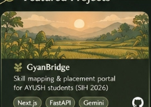
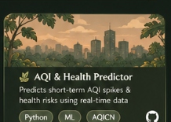
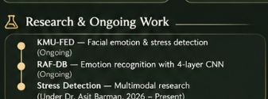
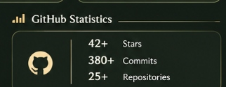
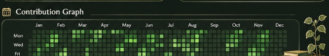
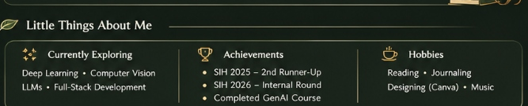

  

### 🍃 About Me
Hi, I'm **Poulami**! A 3rd-year CSE undergraduate passionate about **AI/ML, computer vision, and building impactful applications**. I love working on real-world problems, conducting research, and participating in hackathons.

---

### ⚔️ My Toolbox

  
  
  
  
  
  
   
  
  
  
  
  
  

---

### 🍃 Featured Projects

<table width="100%">
  <tr>
    <td width="33%" align="center">
      
    </td>
    <td width="33%" align="center">
      
    </td>
    <td width="33%" align="center">
      
    </td>
  </tr>
</table>

---

### 🔬 Research & Ongoing Work &nbsp;&nbsp;|&nbsp;&nbsp; 📊 GitHub Statistics

<table width="100%">
  <tr>
    <td width="50%" align="center" valign="top">
      
    </td>
    <td width="50%" align="center" valign="top">
      
    </td>
  </tr>
</table>

---

### 📅 Contribution Graph

  

---

### 🍃 Little Things About Me

  

