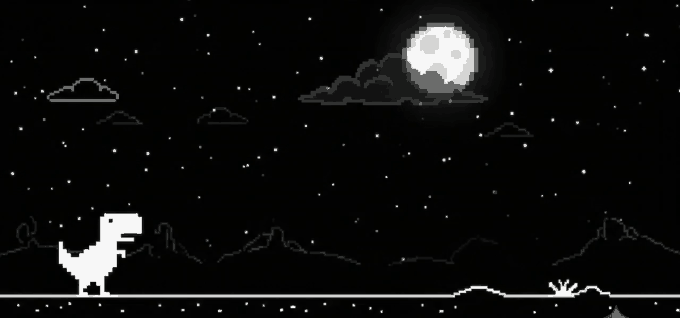
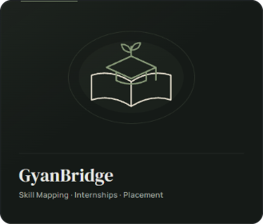
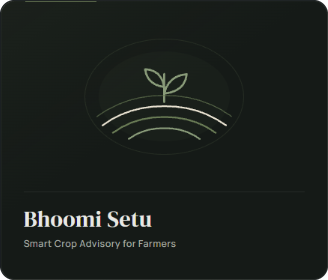
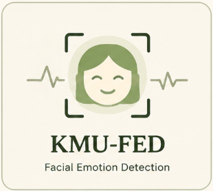
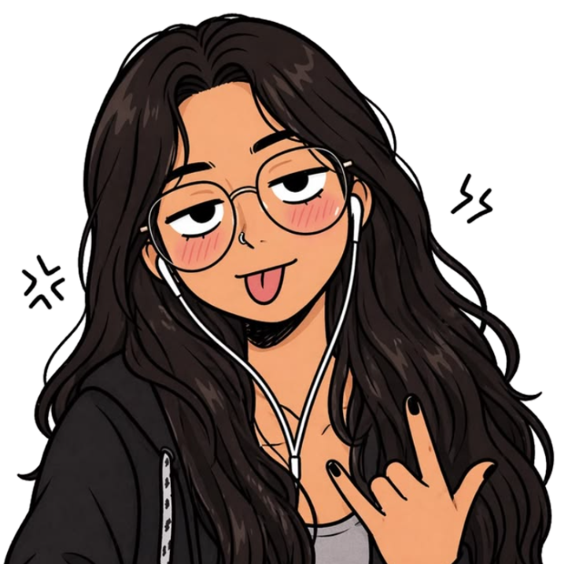

  

##  About Me

### Hi, I'm Poulami Kundu.

I'm a Computer Science undergraduate with a curiosity for intelligent systems and a passion for building things that matter.

My interests lie at the intersection of **AI/ML, Computer Vision, and Web Development**. From experimenting with deep learning models to developing full-stack applications, I enjoy turning ideas into practical solutions.

Currently exploring new possibilities through research, hands-on projects, and hackathons — always learning, always building.

`AI/ML` · `Computer Vision` · `Web Development` · `Research`

---

###  My Toolbox

  
  
  
  
  
  
  
   
  
  
  
  
  
   
  
  
  
  
  
  

---

###  Featured Projects

<table width="100%">
  <tr>
    <td width="33%" align="center" valign="top">
      
        
      

        
      

    </td>
    <td width="33%" align="center" valign="top">
      
        
      

        
      

    </td>
    <td width="33%" align="center" valign="top">
      
        
      

        
      

    </td>
  </tr>
</table>

---

###  Research & Ongoing Work

<table width="100%">
<tr>
<td width="100%">
<h4> &nbsp;<b>KMU-FED</b> &nbsp;·&nbsp; <i>Facial Emotion & Cognitive Stress Detection</i> </h4>

Investigating subtle facial cue dynamics and micro-expressions under cognitive load for non-invasive stress detection and affective classification.

</td>
</tr>
<tr>
<td width="100%">
<h4> &nbsp;<b>RAF-DB</b> &nbsp;·&nbsp; <i>In-The-Wild Facial Expression Recognition</i> </h4>

Designing and evaluating a customized 4-layer Convolutional Neural Network (CNN) architecture optimized for robust feature extraction and emotion classification under real-world occlusions and pose variations.

</td>
</tr>
<tr>
<td width="100%">
<h4> &nbsp;<b>Multimodal Stress Detection</b> &nbsp;·&nbsp; <i>Physiological & Behavioral Signal Fusion</i> </h4>

Developing end-to-end multimodal architectures fusing facial visual cues with physiological signals for continuous human stress assessment. 
<i>Research conducted under the guidance of:</i> <b>Dr. Asit Barman</b> (2026 – Present).

</td>
</tr>
</table>

---

###  GitHub Statistics

<table width="100%">
  <tr>
    <td width="50%" align="center" valign="middle">
      
    </td>
    <td width="50%" align="center" valign="middle">
      
    </td>
  </tr>
</table>

---

###  Little Things About Me

<table width="100%">
<tr>
<td width="100%" valign="top">

<h4> &nbsp;<i>Currently Exploring</i></h4>

 

<h4> &nbsp;<i>Achievements & Milestones</i></h4>

      • <b>Smart India Hackathon (SIH 2025)</b> — 2nd Runner-Up 
      • <b>SIH 2026</b> — Internal Round Finalist 
      • <b>Completed GenAI Specialization</b>

 

<h4> &nbsp;<i>Beyond Code & Hobbies</i></h4>

     <b>Reading</b> &nbsp;&nbsp;&nbsp;&nbsp;&nbsp;
     <b>Journaling</b> &nbsp;&nbsp;&nbsp;&nbsp;&nbsp;
     <b>Designing (Canva)</b> &nbsp;&nbsp;&nbsp;&nbsp;&nbsp;
     <b>Music & Lofi</b>

</td>
</tr>
</table>
