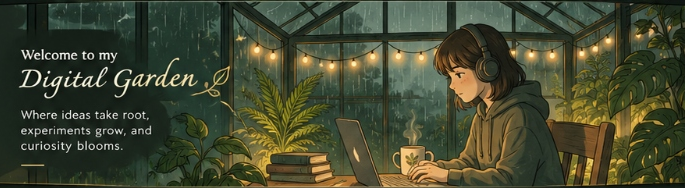

  

### 🍃 About Me
Hi, I'm **Poulami**! A 3rd-year CSE undergraduate passionate about **AI/ML, computer vision, and building impactful applications**. I love working on real-world problems, conducting research, and participating in hackathons.

---

### ⚔️ My Toolbox

  
  
  
  
  
  
   
  
  
  
  
  
  

---

### 🍃 Featured Projects

<table width="100%">
  <tr>
    <td width="33%" align="center" valign="top">
      
        
      <h3 align="center"><b><a href="https://github.com/poulamikundu123/BHOOMI-SETU" style="color: #D4AF37; text-decoration: none;">🌱 BHOOMI-SETU</a></b></h3>
      

        Smart agricultural & land portal bridging rural farmers with digitized records. 
        Uses AI-driven analytics to optimize crop health and land resource allocation.
      

      

        
      

    </td>
    <td width="33%" align="center" valign="top">
      
        
      <h3 align="center"><b><a href="https://github.com/poulamikundu123/GyanBridge" style="color: #D4AF37; text-decoration: none;">🌉 GyanBridge</a></b></h3>
      

        Skill mapping and career placement portal tailored for AYUSH medical students. 
        Built for Smart India Hackathon featuring automated opportunity matching.
      

      

        
      

    </td>
    <td width="33%" align="center" valign="top">
      
        
      <h3 align="center"><b><a href="https://github.com/poulamikundu123/hospital-hostage" style="color: #D4AF37; text-decoration: none;">🏥 hospital-hostage</a></b></h3>
      

        Healthcare vulnerability scanner monitoring critical hospital network security. 
        Provides automated incident detection to prevent emergency medical system lockouts.
      

      

        
      

    </td>
  </tr>
</table>

---

### 🔬 Research & Ongoing Work &nbsp;&nbsp;|&nbsp;&nbsp; 📊 Live GitHub Statistics

<table width="100%">
  <tr>
    <td width="50%" valign="top">
      <h4>🔬 Research & Ongoing Work</h4>
      <ul>
        <li>🟡 <b>KMU-FED</b> — Facial emotion & stress detection <i>(Ongoing)</i></li>
        <li>🟡 <b>RAF-DB</b> — Emotion recognition with 4-layer CNN <i>(Ongoing)</i></li>
        <li>🟡 <b>Stress Detection</b> — Multimodal research <i>(Under Dr. Asit Barman, 2026 – Present)</i></li>
      </ul>
    </td>
    <td width="50%" align="center" valign="top">
      
    </td>
  </tr>
</table>

---

### 🍃 Little Things About Me

<table width="100%">
  <tr>
    <td width="66%" valign="middle">
      <h4>✨ <b>Currently Exploring</b></h4>
      

        
        
        
        
      

      <h4>🏆 <b>Achievements & Milestones</b></h4>
      

        🥇 <b>Smart India Hackathon (SIH 2025)</b> — 2nd Runner-Up 
        🎯 <b>SIH 2026</b> — Internal Round Finalist 
        📜 <b>Completed GenAI Specialization</b>
      

      <h4>☕ <b>Beyond Code & Hobbies</b></h4>
      

        📚 <i>Reading</i> &nbsp;•&nbsp; ✍️ <i>Journaling</i> &nbsp;•&nbsp; 🎨 <i>Designing (Canva)</i> &nbsp;•&nbsp; 🎧 <i>Music & Lofi</i>
      

    </td>
    <td width="34%" align="center" valign="middle">
      
    </td>
  </tr>
</table>
